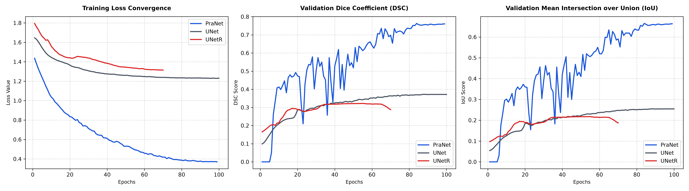
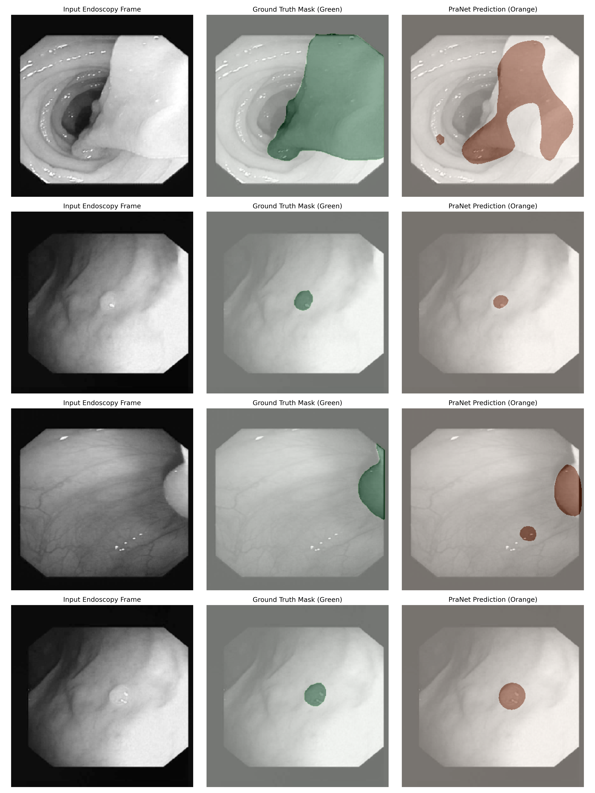
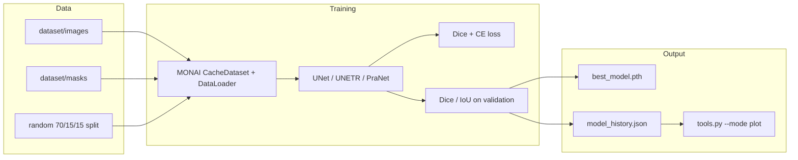

# Endoscopy Polyp Segmentation

I built this benchmark to compare three segmentation architectures on endoscopy frames: a from-scratch UNet, a from-scratch UNetR, and a PraNet with a Res2Net backbone and reverse attention. All three share one data pipeline, one Dice plus cross-entropy loss, one metric recorder, and one CLI, so a run changes the architecture rather than the surrounding code. PraNet reaches 0.7628 validation DSC, while the much larger UNetR reaches 0.3222; on this dataset the convolutional decoder's inductive bias mattered more than parameter count. The repository is for people who want a small, readable PyTorch and MONAI benchmark, not a clinical tool.



_Validation curves from the three saved runs. The plot is generated by `tools.py --mode plot` from `artifacts/*/model_history.json`._

## Contents

- [Results](#results)
- [Dataset](#dataset)
- [Requirements](#requirements)
- [Reproduce](#reproduce)
- [How it works](#how-it-works)
- [Configuration](#configuration)
- [Project layout](#project-layout)
- [Limits](#limits)
- [Stack](#stack)

## Results

| Model | Parameters | Best val DSC | Best val IoU | Best epoch | Run length |
|---|---:|---:|---:|---:|---:|
| PraNet (Res2Net) | 24.48 M | 0.7628 | 0.6652 | 84 | 99, early stop |
| UNet | 0.66 M | 0.3722 | 0.2548 | 88 | 100 |
| UNetR | 87.90 M | 0.3222 | 0.2173 | 55 | 70, early stop |

The table reports the best validation Dice and IoU at the epoch with the highest validation DSC. All runs use 352×352 inputs and a random 70/15/15 frame-level split generated with seed 42. I trained one run per architecture, all from scratch. The test split is created by the loader but is not evaluated by the current training loop.

The parameter counts come from the `torchinfo` summaries in `artifacts/<run>/architecture.txt`. The scores come from `artifacts/<run>/model_history.json`.



_Example prediction overlay from the saved PraNet run. The current `src/infer.py` writes `.pt` binary masks, not PNG overlays; this figure was generated separately._

PraNet is clearly ahead in this run, and UNet is second while UNetR is third. UNetR is much larger than UNet, which makes the result a useful counterexample to a parameter-count argument. The result is one run per architecture on one pooled dataset; treat it as a benchmark signal, not a general claim about transformers.

## Dataset

The benchmark pools five public polyp datasets. After `tools.py --mode download`, the `dataset/` directory contains 2,248 image/mask pairs:

| Dataset | Pairs | Source |
| --- | ---: | --- |
| Kvasir-SEG | 1,000 | [datasets.simula.no](https://datasets.simula.no/downloads/kvasir-seg.zip) |
| CVC-ClinicDB | 612 | [Kaggle: balraj98/cvcclinicdb](https://www.kaggle.com/datasets/balraj98/cvcclinicdb) |
| CVC-ColonDB | 380 | [Kaggle: longvil/cvc-colondb](https://www.kaggle.com/datasets/longvil/cvc-colondb) |
| ETIS-LaribPolypDB | 196 | [Kaggle: nguyenvoquocduong/etis-laribpolypdb](https://www.kaggle.com/datasets/nguyenvoquocduong/etis-laribpolypdb) |
| CVC-300 | 60 | [Kaggle: nourabentaher/cvc-300](https://www.kaggle.com/datasets/nourabentaher/cvc-300) |

`tools.py --mode download` fetches Kvasir-SEG directly and the other four from Kaggle. It expects `aria2c` and the Kaggle CLI on `PATH`. The local directory is flat:

```text
dataset/
├── images/
│   ├── cvc_300_149.png
│   ├── kvasir_cju0qkwl35piu0993l0dewei2.jpg
│   └── ...
└── masks/
    ├── cvc_300_149.png
    ├── kvasir_cju0qkwl35piu0993l0dewei2.jpg
    └── ...
```

`build_dataloaders` pairs the sorted image and mask paths, then splits them 70/15/15 with a seeded generator. The split is frame-level; no patient or video IDs are stored.

The loader currently accepts `.png` only. `generate_notebook.py` builds a Kaggle notebook that converts every dataset to PNG. If you use `tools.py --mode download` locally, convert the 1,000 Kvasir JPGs to PNG before training; otherwise the loader skips them and trains on 1,248 pairs.

I do not redistribute the images. Each dataset page has its own license and citation terms; check them before using the data.

## Requirements

- Python 3.10 or newer. The local venv I used for the import checks runs 3.14.9.
- PyTorch 2.x and MONAI 1.x. The local venv has torch 2.12.1 and MONAI 1.6.0.
- NumPy, Matplotlib, tqdm, and torchinfo.
- About 400 MB for the dataset and 430 MB for the three checkpoints.
- Training is compute-heavy. CPU is enough for import checks and tiny smoke tests, not for the full runs.
- `tools.py --mode download` also needs `aria2c` and the Kaggle CLI.
- The commands below assume a POSIX shell. I ran the checks on Linux.

## Reproduce

### Install

```bash
git clone https://github.com/abderrahmenex86/Polyp-Segmentation
cd Polyp-Segmentation
python -m venv .venv
source .venv/bin/activate
pip install torch monai numpy matplotlib tqdm torchinfo
```

The checked-in `requirements.txt` is not used by this quickstart because it omits `torchinfo` and includes an unused `segment_anything` entry. The command above installs the packages the code imports.

### Data

```bash
python tools.py --mode download --path dataset
python tools.py --mode verify --path dataset
```

```text
[VERIFY] [11/07 - 22:48] Images: 2248 | Masks: 2248
```

The timestamp will differ. If you already have the images, skip the download and put them in `dataset/images` and `dataset/masks`. Convert JPGs to PNG before training.

### Train

```bash
python main.py --train --architecture PraNet --dataset_directory dataset --batch_size 64 --epochs 100 --warmup_epochs 10 --random_seed 42
```

The saved PraNet run used these settings. The UNet run used `--batch_size 64 --warmup_epochs 5`; the UNetR run used `--batch_size 32 --warmup_epochs 10`. The other defaults are in the configuration table.

A training run writes `artifacts/<timestamp>_<architecture>/` with `hyperparameters.json`, `model_history.json`, `architecture.txt`, and `best_model.pth`.

Expected output at the best epoch (the exact loss depends on the run):

```text
[TRAIN] [07/02 - 06:37] Epoch 84 | Loss: 0.3800 | Val DSC: 0.7628
```

### Evaluate

The training loop keeps the best validation checkpoint but does not evaluate the test split. To print the best validation row from a saved run, replace `<run_dir>` with one of the directories under `artifacts/`:

```bash
python - <<'PY'
import json
h = json.load(open("artifacts/<run_dir>/model_history.json"))
i = max(range(len(h["val_dice"])), key=h["val_dice"].__getitem__)
print(f"epoch {i + 1}: DSC {h['val_dice'][i]:.4f} IoU {h['val_iou'][i]:.4f}")
PY
```

```text
epoch 84: DSC 0.7628 IoU 0.6652
```

The current `--test` path loads `best_model.pth` and runs `eval_epoch` on the test loader, but the CLI discards the returned scores. It also reloads the saved `dataset_directory`, so a checkpoint trained on Kaggle expects `/kaggle/working/dataset` unless you edit `hyperparameters.json`. Use the history command above for the reported table.

### Inference

```bash
python main.py --infer --inference_dir dataset/images --run_dir artifacts/<run_dir>
```

```text
[INFER] [..] Starting inference on 2248 frames.
[INFER] [..] Inference saved to artifacts/<run_dir>/predictions
```

`src/infer.py` writes one `.pt` binary mask per input image. It does not write PNG overlays.

### Plot

```bash
python tools.py --mode plot
```

```text
[PLOT] [..] Comparative metrics graph successfully serialized to: docs/figs/comparative_metrics_evaluation.png
```

Run this after training; it reads `artifacts/*/model_history.json`.

## How it works

`src/dataset.py` discovers the flat `images/` and `masks/` folders, pairs the sorted paths, and builds MONAI `CacheDataset` objects. Training adds random horizontal and vertical flips and a random affine transform; validation and test skip those random steps.

`src/factory.py` builds one of three models. `UNet` is a five-level MONAI UNet with channels `(16, 32, 64, 128, 256)`. `UNETR` is MONAI's 2D transformer with a 16×16 patch size. `PraNet` uses a Res2Net backbone, three receptive-field blocks with four parallel branches each, a partial decoder, and two reverse-attention stages.

`src/trainer.py` runs the training loop with AdamW, a linear warmup followed by cosine decay, gradient clipping, and early stopping on validation DSC. The loss is MONAI's `DiceCELoss` with sigmoid activation. Validation computes `DiceMetric` and `MeanIoU` at a fixed 0.5 threshold. The best checkpoint and the per-epoch history are written under `artifacts/`.



## Configuration

| Flag | Default | What it does |
| --- | --- | --- |
| `--architecture` | `UNet` | `UNet`, `UNetR`, or `PraNet` |
| `--dataset_directory` | `dataset` | Root containing `images/` and `masks/` |
| `--run_dir` | none | Existing run directory for `--test` or `--infer` |
| `--inference_dir` | `dataset/inference` | Flat image folder for `--infer` |
| `--batch_size` | 8 | Training and validation batch size |
| `--epochs` | 100 | Maximum epochs |
| `--warmup_epochs` | 10 | Linear warmup epochs |
| `--patience` | 15 | Early-stopping patience |
| `--learning_rate` | 1e-4 | AdamW learning rate |
| `--weight_decay` | 1e-5 | AdamW weight decay |
| `--clip_threshold` | 1.0 | Gradient-norm clip |
| `--image_height` | 352 | Input height |
| `--image_width` | 352 | Input width |
| `--in_channels` | 3 | Input channels |
| `--out_classes` | 1 | Output classes |
| `--random_seed` | 42 | Split generator seed |

| Mode | What it does |
| --- | --- |
| `--profile` | Probe memory limits and log a batch-size recommendation; skips on CPU |
| `--train` | Train a model and write a run directory |
| `--test` | Load `best_model.pth` and run `eval_epoch`; the current CLI does not print the scores |
| `--infer` | Load `best_model.pth` and write `.pt` masks |

`--random_seed` controls the train/val/test split only. It does not seed torch, NumPy, or the DataLoader workers, so training is not fully deterministic.

`tools.py` takes these flags:

| Flag | Default | What it does |
| --- | --- | --- |
| `--mode` | required | `download`, `verify`, or `plot` |
| `--path` | `dataset` | Dataset root for `download` and `verify` |

## Project layout

| Path | What it is |
| --- | --- |
| `main.py` | CLI for profile, train, test, and infer |
| `src/dataset.py` | Data discovery, transforms, and DataLoaders |
| `src/models.py` | Res2Net, PraNet, and the Dice+CE loss |
| `src/factory.py` | Model, optimizer, and scheduler builders |
| `src/helpers.py` | Logging, JSON, run-directory, and pre-training plot helpers |
| `src/trainer.py` | Training loop, validation, and run artifacts |
| `src/profile.py` | Memory-limit probe |
| `src/infer.py` | Checkpoint inference |
| `tools.py` | Download, verify, and plot utilities |
| `generate_notebook.py` | Builds the Kaggle notebook |
| `requirements.txt` | Dependency list; the quickstart installs the missing `torchinfo` explicitly |
| `artifacts/` | Per-run config, history, checkpoint, and predictions (gitignored) |
| `dataset/` | Flat images and masks (gitignored) |
| `docs/figs/` | Committed figures |

## Limits

This is not a diagnostic tool. The models were trained on public research datasets, not on a clinical population, and I have not validated them against patient outcomes or clinician annotations. Do not use the outputs for patient care.

The benchmark covers polyp segmentation only. It does not classify polyps, estimate malignancy, or handle other endoscopy findings. The five datasets share a research collection bias; other scopes, staining protocols, and patient groups are untested.

## Stack

| Tool | Version | Role |
| --- | --- | --- |
| Python | 3.10+ (local 3.14.9) | Runtime |
| PyTorch | 2.x (local 2.12.1) | Models and training |
| MONAI | 1.x (local 1.6.0) | Datasets, transforms, metrics, UNet/UNETR |
| torchinfo | 1.8.0 (local) | Architecture summaries |
| NumPy | unpinned | Array handling |
| Matplotlib | unpinned | Plots |
| tqdm | unpinned | Progress and log output |

Plain PyTorch and MONAI; no experiment tracker or extra framework.
